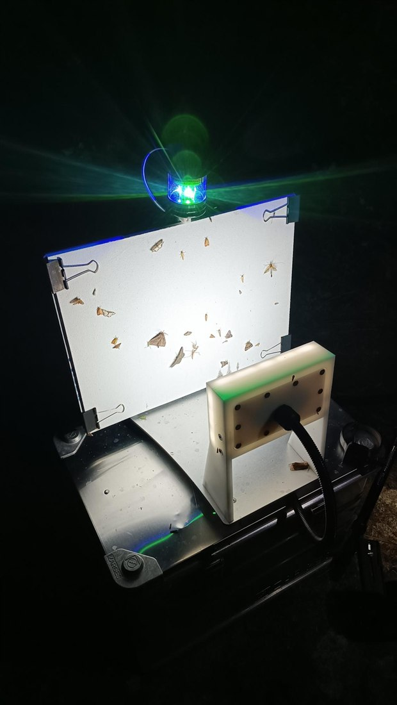
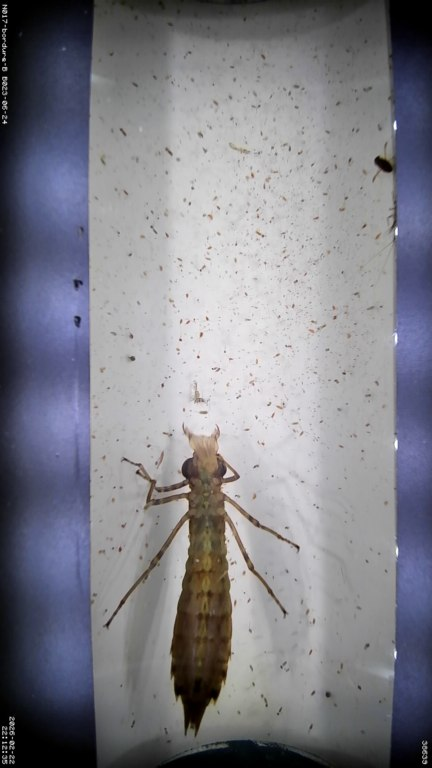

---
# ---------------------------------------------------------------------------
# extended-pitch.qmd -- full-pitch.qmd with three extra slides after the
# packages overview, one per package, aimed at partners deciding how to take
# part. Each slide lists its package's activities in proposal order and says
# who leads each one, what partners get from it and, where partners lead or
# support, how they can contribute. Everything else is a copy of the full
# pitch; keep the two in step by hand.
#
# The lead roles on the three package slides do NOT come from the proposal
# .docx. They come from a revised Section 6.1 table supplied by the activity
# leads on 13 Oct 2026, which adds a "Coordinator / contributor" column the
# .docx does not yet carry. The column maps onto the slide labels as follows:
#   coordinator   -> Hub-led
#   coordinator+  -> Hub-led (partner-supported)
#   contributor+  -> Partner-led (hub-supported)
#   contributor   -> Partner-led  (A1.7's "supported by coordinator" is dropped
#                    at the leads' request)
# The "Get" and "Contribute" lines were written with the activity leads and
# summarise Section 6.2; they are paraphrase, not quotation.
#
# What follows is full-pitch.qmd's own header, which still applies to every
# other slide:
#
# full-pitch.qmd -- the 7-10 minute pitch for MANTIS. The deck the hub site
# calls "the full pitch"; core-pitch.qmd is the five-slide distillation of it.
#
# Every number, name and claim on these slides comes from
# documentation/MANTIS_Additional_Activity_Proposal_T2.5.3.docx.md, under the
# same rule the figures obey: the proposal .docx is the only permitted source
# of facts. Where the proposal carries an unfilled placeholder -- O1's device
# count, and the per-partner personnel line in 11.1 -- the slide says what the
# proposal supports and no more.
#
# The chain figure is not retyped here: its heading and alt text are read out
# of figures/fig01-connective-tissue.yml at render time, so they cannot drift
# away from the figure. It needs out/fig01-slide.svg -- run targets::tar_make()
# first.
# ---------------------------------------------------------------------------
title: "MANTIS"
subtitle: "A Hub for Monitoring with Automated and Novel Technologies Based on Image and Sound"
author:
- name: Jamie Alison, Aarhus University
- name: Jonas Gaigr, Nature Conservation Agency CZ
  affiliation: Nature Conservation Agency CZ
institute: "Biodiversa+ WP2 · Task 2.5.3 additional activity"
title-image: images/20250703024959-snapshot.jpg
format:
  biodiversaplus-revealjs:
    navigation-mode: linear
    include-in-header:
      text: |
        <style>
        /* A figure slide is the figure. The message is a full sentence, so it
           is set as a running head rather than a display heading -- the same
           treatment slides.qmd uses. */
        .reveal .figure-slide h2 {
          font-size: 1.05em; line-height: 1.2; margin-bottom: 0.15em;
        }
        .reveal .figure-slide img {
          margin: 0; border: none; box-shadow: none; background: none;
        }
        /* The chain is the core-message slide and this deck shows only one
           figure, so it gets the whole canvas: the slide drops the footer
           chrome (.bd-no-chrome on the heading) and the padding that reserved
           room for it, which lets Quarto's auto-stretch size the figure from
           the full slide height rather than from what the footer left over. */
        .reveal .slides section.slide.figure-slide {
          padding: 35px 40px 32px 40px;
        }
        /* The objectives table is five rows of real text; at the deck's 12pt
           body size it clears the footer rule without scrolling. */
        .reveal .compact table { font-size: 0.9em; }
        .reveal .compact table th,
        .reveal .compact table td { padding: 0.3em 0.6em; vertical-align: top; }
        /* Nineteen activities across three columns: tighter leading so the
           packages slide holds all of them above the footer rule, and a
           two-line box for the column headers so one wrapping header does not
           push its own bullets out of line with the other two columns. */
        .reveal .packages li { margin-bottom: 0.2em; line-height: 1.25; }
        .reveal .packages .column > h4:first-child { min-height: 2.2em; }
        .reveal .lede { font-size: 1.111em; }

        /* Package slides. One row per activity, in proposal order: the task
           with its role tag, then what partners get, then how they contribute.
           Hub-led rows have no third cell -- partners' part in them is implied
           by the partner-led tasks -- so the grid leaves that column blank.
           Role colours run along partner involvement, navy (hub) through
           turquoise to green (partner), all taken from the brand palette and
           none of them the CORE/ENHANCED/SCALABLE hues the figures reserve. */
        .reveal .roles h2 { margin-bottom: 0.3em; }
        .reveal .tasks { font-size: 0.95em; line-height: 1.25; }
        .reveal .tasks .task {
          display: grid; grid-template-columns: 15.5em 1fr 1fr;
          column-gap: 1em; align-items: start;
          padding: 0.3em 0.6em; margin-bottom: 0.25em;
          border-left: 0.35em solid var(--role); background: var(--role-wash);
        }
        .reveal .tasks .task > p { margin: 0; }
        .reveal .tasks .task-head {
          border-left-color: transparent; background: none;
          padding-top: 0; padding-bottom: 0.1em;
          font-weight: 700; color: #103B60;
        }
        .reveal .tasks .tid { font-weight: 700; margin-right: 0.3em; }
        .reveal .tasks .role {
          display: table; margin-top: 0.2em;
          padding: 0.05em 0.5em; border-radius: 0.8em;
          font-size: 0.85em; font-weight: 700;
          background: var(--role); color: var(--role-ink);
        }
        .reveal .tasks .hub      { --role: #103B60; --role-wash: rgba(16, 59, 96, 0.07);  --role-ink: #FFFFFF; }
        .reveal .tasks .hub-plus { --role: #00918F; --role-wash: rgba(0, 145, 143, 0.09); --role-ink: #FFFFFF; }
        .reveal .tasks .partner  { --role: #98C01E; --role-wash: rgba(152, 192, 30, 0.16); --role-ink: #000000; }
        .reveal .roles .topup { margin-top: 0.4em; }

        /* Slides with little text: larger body text, so the content fills
           the slide rather than sitting in its top half. The heading keeps
           its size. */
        .reveal .roomy > :not(h2) { font-size: var(--roomy, 1.2em); }
        .reveal .roomy li { margin-bottom: 0.5em; }
        /* Package 2 has five rows rather than seven, so they get more room. */
        .reveal .roles.few .tasks { font-size: 1.1em; }
        .reveal .roles.few .tasks .task { padding: 0.5em 0.6em; margin-bottom: 0.35em; }
        .reveal .tech .columns { font-size: 1.06em; }

        /* Technologies slide: one column per device family, a photograph of
           fixed height on top so the three captions start level. The insect
           column carries two devices, so its photographs split the width. */
        .reveal .tech img {
          width: 100%; height: 270px; object-fit: cover;
          margin: 0 0 0.4em 0; border: none; box-shadow: none;
        }
        .reveal .tech .pair p { display: flex; gap: 0.3em; margin: 0 0 13px 0; }
        .reveal .tech .pair img { width: calc(50% - 0.15em); }
        .reveal .tech h4 { margin: 0 0 0.25em 0; }
        .reveal .tech p { margin: 0 0 0.4em 0; line-height: 1.3; }
        .reveal .tech ul { margin-bottom: 0.4em; }
        </style>
---

```{r}
#| label: setup
#| include: false
for (f in c("profiles", "spec", "render", "checks", "document")) {
  source(file.path("R", paste0(f, ".R")))
}
```

# Why a hub for sensor-based biodiversity monitoring {.turquoise}

::: {.notes}
About twelve minutes. If you have less time, shorten "Three shared
bottlenecks" to its first point and give the three package slides one
sentence each.
:::

## The sensors are on the ground, but not always joined up {.roomy}

::: {.columns}
::: {.column}
#### Deployed today

- **ABMS pilot (2.6.5)** – AMI traps and acoustic recorders in three habitat types across **11 countries**
- **IAS pilot (2.6.2)** – an AMI trap and a CamAlien unit in **10 countries**
- **BiodivPond pilot (2.6.8)** – acoustic recorders in **ten countries**
- **MAMBO** and related projects – AI-based insect camera traps in **over 30 countries**
- **TABMON** – autonomous acoustic sensors across **four countries**
:::

::: {.column}
#### Operated as independent efforts

- Ad hoc methods for annotation, verification and AI model selection, project by project
- Interoperability bottlenecks between devices, national databases and European infrastructures
- Few cross-country verified reference datasets, and those that exist are scattered and often poorly curated
- Hardware maintained country by country, needing more transnational support than expected
:::
:::

[Partners have access to their own data, but often lack the tools or capacity to use it for policy.]{.small}

::: {.notes}
75 seconds. The deployments exist and the devices work, and Biodiversa+ has
already funded many of them. What is missing is a way to join them up.
:::

## Three technologies {.tech}

::: {.columns}
::: {.column}
::: {.pair}
 
:::

#### Insect cameras: AMI, NewtCam

- AMI: nocturnal insects photographed at a lit sheet
- NewtCam: pond invertebrates and amphibians, underwater

[ABMS (2.6.5), IAS (2.6.2), MAMBO]{.small}
:::

::: {.column}
{fig-alt="A close view of the CamAlien rig: a lens in a black housing beside a white weatherproof control box, strapped to a roof bar."}

#### Vehicle-mounted cameras: CamAlien

- High-speed, car-mounted camera with GPS
- Maps invasive alien plants along roads

[IAS pilot (2.6.2)]{.small}
:::

::: {.column}
{fig-alt="Two olive-green Song Meter recorders strapped to the trunk of a fruit tree at the edge of an open meadow."}

#### Bioacoustics

- Birds (audible) and bats (ultrasound)
- HydroMoth: amphibians, underwater

[ABMS (2.6.5), BiodivPond (2.6.8), TABMON]{.small}
:::
:::

::: {.notes}
45 seconds. Insect cameras: AMI on land, already deployed across the pilots;
NewtCam, an underwater camera MANTIS would put into operation (A1.5), not yet
deployed. CamAlien: invasive plants mapped from a moving car. Acoustics: birds
and bats on land, amphibians underwater with HydroMoths (A1.6). All of them
produce images or sound faster than experts can check by hand, which leads to
the next slide.
:::

## Three shared bottlenecks {.roomy style="--roomy: 1.6em"}

1. **Verification cannot keep up.** The volume of image and sound data has grown faster than the community's capacity to verify it, calibrate the AI models processing it, and make the outputs comparable across countries and taxa.
2. **AI accuracy is unknown outside its training context.** Moth classifiers trained on Danish and UK expert-verified images performed poorly in Slovakia, Croatia, Bulgaria and Israel. TABMON names the same annotation bottleneck as its principal constraint on scaling.
3. **Sensors still need field visits and coordination.** A substantial share of deployed acoustic recorders require manual retrieval rather than remote transfer, limiting temporal coverage and cost-efficiency. Partners need to know when to deploy them, and to what end.

::: {.notes}
90 seconds. Model calibration, sensor connectivity and annotation protocol
design are not specific to one country, so there is little sense in solving
them separately in up to 27 Member States.
:::

## The aim {.roomy style="--roomy: 1.7em"}

- **Connect data acquisition** – align protocols, deployments and annotations. Extend spatial and taxonomic coverage with new sensor deployments.  [Package 1]{.small}
- **Connect the data** – harmonise datasets and metadata. Ensure flow from images and sounds to quality-controlled indicators, including transnational benchmarking of AI models.  [Package 2]{.small}
- **Connect the community** – link the users of these technologies to one another, and to the skills and resources that sustain a transnational effort.  [Package 3]{.small}

[MANTIS could develop into a Thematic Hub associated with an EBOCC. Core Activity 3 primary; Core Activities 2 and 4 secondary.]{.small}

::: {.notes}
60 seconds. The proposal describes MANTIS as "connective tissue": it builds
infrastructure for monitoring itself, not another technology or another
taxon's dataset. That is what Biodiversa+ asks of a Task 2.5.3 activity, as
opposed to a research grant.
:::

# What the hub changes {.blue}

## At the end of this activity… {.roomy style="--roomy: 1.7em"}

> …national and regional automated monitoring efforts using image and sound technologies will function as a connected, transnational system rather than isolated national deployments.

**Because MANTIS will have –**

- aligned data acquisition protocols and coverage across partners;
- harmonised the resulting datasets and metadata into a quality-controlled flow from raw sensor output to indicators;
- built the community, skills and self-sustaining infrastructure needed to carry this connected effort beyond the funded period.

::: {.notes}
45 seconds. The quoted sentence is from the proposal. The three points under
it correspond to the three packages.
:::

```{r}
#| label: chain
#| output: asis
# The chain figure, with its heading and alt text read out of the spec rather
# than retyped -- there is one copy of each, in the spec.
spec <- Filter(function(s) identical(s$id, "fig01"), document_specs())[[1]]
cat(sprintf("\n## %s {.figure-slide .bd-no-chrome}\n\n", spec$message))
cat(sprintf('{fig-alt="%s"}\n\n', figure_path(spec, "slide"), spec$alt))
cat("::: {.notes}\n",
    "75 seconds. Go through it left to right once, then point out the numbered\n",
    "gates: deployment registration, expert verification, AI benchmarking,\n",
    "standards conformance. These are what MANTIS adds. Most of what lies either\n",
    "side of them already exists somewhere in Europe.\n",
    ":::\n\n", sep = "")
```

## Five objectives {.compact}

| Objective | Target and indicator | Deadline |
|:---|:---|:---|
| **O1** Deployment registration | 100% of active AMI, CamAlien and acoustic deployments across ≥8 partner countries, registered and machine-readable in a Camtrap DP-compliant master database | 30 Sep 2028 |
| **O2** Policy-relevant indicators | ≥4 finalised indicators live on the MANTIS dashboard, each mapped to NRR Art. 10 / EU-PoMS, the Habitats Directive, the Birds Directive or IAS Regulation 1143/2014, and auto-updating from GBIF | 30 Sep 2028 |
| **O3** Verified annotations | ≥5,000 expert-verified annotations published under FAIR principles, including ≥2,000 NewtCam annotations; ≥20% reviewed by experts from ≥2 countries | 31 Dec 2027 |
| **O4** Training | 25 summer-school participants from ≥12 countries; ≥20 distinct organisations attending ≥1 of the 8 online events | 30 Jun 2028 |
| **O5** Roadmap beyond 2028 | Roadmap endorsed by ≥2/3 of partners at BioMonWeek 2028, naming ≥2 concrete funding or hosting pathways | 30 Jun 2028 |

::: {.notes}
75 seconds. No need to read the table. Each objective has a date and a
threshold, so it is clear at the end whether it was met. O3 is the one most
other work depends on; O5 decides what happens after the funding ends.
:::

# How it gets done {.green}

## Nineteen activities, three packages {.packages}

::: {.columns}
::: {.column}
#### Package 1 – Scheme improvement
[Core Activity 2 · seven activities]{.small}

- Unified deployment registration system [A1.1]{.small}
- Verified datasets for transnational quality control [A1.2]{.small}
- Scaling contributions toward verification [A1.3]{.small}
- Sensor upgrades in existing networks [A1.4]{.small}
- Underwater imaging of benthic invertebrates [A1.5]{.small}
- Underwater acoustic pilot in ponds [A1.6]{.small}
- Scaling spatial coverage of existing schemes [A1.7]{.small}
:::

::: {.column}
#### Package 2 – Data flows
[Core Activity 3, primary · five activities]{.small}

- Transnational benchmarking of AI, and pipeline refinement [A2.1]{.small}
- Gold-standard implementation of media, label and annotation standards [A2.2]{.small}
- Workflows for policy-relevant indicators [A2.3]{.small}
- Scaling contributions toward transnational indicators [A2.4]{.small}
- Exemplary data-flow architecture for AMI [A2.5]{.small}
:::

::: {.column}
#### Package 3 – Capacity building
[Core Activity 4 · seven activities]{.small}

- Platform for communication and signposting [A3.1]{.small}
- MANTIS summer school [A3.2]{.small}
- Roadmap for a technical hub [A3.3]{.small}
- Technical fora and curated user guidance [A3.4]{.small}
- Two workshops on verification [A3.5]{.small}
- Four device webinars [A3.6]{.small}
- Two workshops on AI processing [A3.7]{.small}
:::
:::

[Nine deliverables and sixteen milestones, between 1 January 2027 and 30 September 2028.]{.small}

::: {.notes}
30 seconds. An overview only; the next three slides cover each package. One
sentence per column: Package 1 improves the schemes that feed the chain,
Package 2 carries the data through it, Package 3 builds the skills and
resources to keep it running. Key outputs: the registration system online
(M1.3, Aug 27), four indicators on the dashboard (M2.2, Jul 28), and the
roadmap (D3.1, Sep 28).
:::

## Package 1 – Scheme improvement {.roles}

::: {.tasks}
::: {.task .task-head}
Task

What partners get

How partners contribute
:::

::: {.task .hub}
[A1.1]{.tid} Deployment registration
[Hub-led]{.role}

Your deployments on one joined-up map and dashboard
:::

::: {.task .hub}
[A1.2]{.tid} Verified datasets
[Hub-led]{.role}

Shared annotation systems/protocols for verified species records
:::

::: {.task .partner}
[A1.3]{.tid} Scaling verification
[Partner-led]{.role}

AI checked by your own experts, for your own region

Expert annotation time
:::

::: {.task .partner}
[A1.4]{.tid} Sensor upgrades
[Partner-led (hub-supported)]{.role}

Devices that report remotely and run on solar, fewer field visits

Equipment, deployment and upkeep
:::

::: {.task .hub-plus}
[A1.5]{.tid} NewtCam in ponds
[Hub-led (partner-supported)]{.role}

Guidelines for underwater imaging of pond invertebrates, cross-evaluation with eDNA

Equipment and maintenance of devices at two pond sites
:::

::: {.task .hub-plus}
[A1.6]{.tid} Underwater acoustics
[Hub-led (partner-supported)]{.role}

Guidelines for underwater acoustic monitoring of amphibians, reference sound library

Equipment and maintenance of devices at two pond sites
:::

::: {.task .partner}
[A1.7]{.tid} Spatial coverage
[Partner-led]{.role}

New AMI and acoustic stations, linked to the European network

Equipment and maintenance of devices at a coverage-gap site
:::
:::

[Partner-led tasks are where in-kind effort or EC top-up goes. Top-up does not unlock further EC funding, but helps bring the hub to life.]{.small .topup}

::: {.notes}
60 seconds. The colours show who leads: navy is delivered by the hub for all
partners, turquoise is hub-led work partners can support, green is led by
partners. Package 1 has the most partner-led tasks – verification, upgrades and
new stations in partners' own countries. For A1.4 to A1.7 an in-kind
contribution can include providing or buying the equipment as well as running
it.
:::

## Package 2 – Data flows {.roles .few}

::: {.tasks}
::: {.task .task-head}
Task

What partners get

How partners contribute
:::

::: {.task .hub}
[A2.1]{.tid} AI benchmarking
[Hub-led]{.role}

Reliability scores for AI identifications, by taxon and region
:::

::: {.task .hub}
[A2.2]{.tid} Data standards
[Hub-led]{.role}

Worked examples for publishing image and sound data to GBIF
:::

::: {.task .hub}
[A2.3]{.tid} Policy indicators
[Hub-led]{.role}

Indicators from sensor data mapping to NRR, Habitats, Birds and IAS reporting
:::

::: {.task .partner}
[A2.4]{.tid} Scaling indicators
[Partner-led]{.role}

Indicators that reflect partners' needs

Policy and taxonomic expertise for indicator design
:::

::: {.task .hub}
[A2.5]{.tid} AMI data flow
[Hub-led]{.role}

A near one-click pipeline from AMI images to indicators
:::
:::

[Partner-led tasks are where in-kind effort or EC top-up goes. Top-up does not unlock further EC funding, but helps bring the hub to life.]{.small .topup}

::: {.notes}
45 seconds. Package 2 is mostly hub-led. The partner-led task is A2.4: partner
expertise helps the indicators reflect national reporting needs.
:::

## Package 3 – Capacity building {.roles}

::: {.tasks}
::: {.task .task-head}
Task

What partners get

How partners contribute
:::

::: {.task .hub}
[A3.1]{.tid} Platform
[Hub-led]{.role}

One place to find tools, standards, indicator dashboards
:::

::: {.task .hub}
[A3.2]{.tid} Summer school
[Hub-led]{.role}

Hands-on training for early-career staff and students
:::

::: {.task .hub-plus}
[A3.3]{.tid} Hub roadmap
[Hub-led (partner-supported)]{.role}

A plan to keep the hub running after 2028

Ideas on roles, governance, hosting and funding
:::

::: {.task .hub-plus}
[A3.4]{.tid} Technical fora
[Hub-led (partner-supported)]{.role}

A moderated place to ask about AMI, acoustic and CamAlien systems

Moderation, guidance and lessons from your own experience
:::

::: {.task .hub}
[A3.5]{.tid} Verification workshops
[Hub-led]{.role}

Training to verify images and sounds from your deployments
:::

::: {.task .hub}
[A3.6]{.tid} Device webinars
[Hub-led]{.role}

Lessons from big projects running AMI, CamAlien and acoustic devices
:::

::: {.task .hub}
[A3.7]{.tid} AI processing workshops
[Hub-led]{.role}

Skills/resources to run open-source AI models on your own data
:::
:::

[Partner-led tasks are where in-kind effort or EC top-up goes. Top-up does not unlock further EC funding, but helps bring the hub to life.]{.small .topup}

::: {.notes}
45 seconds. Package 3 is available to all partners: training, a platform and a
place to ask questions. Partners can support the two turquoise tasks – the fora
draw on partners' experience, and the roadmap sets out what happens after 2028.
:::

## Budget tiers {.roomy style="--roomy: 1.55em"}

- **CORE** – delivered by the two lead partners: registration system, verified datasets, AI benchmarking, standards, indicators, platform, summer school, roadmap. [**€314,630.80**]{.small}
- **CORE + ENHANCED** – adds the underwater acoustic pilot, the one-click AMI pipeline, technical fora, verification and AI-processing workshops, and the device webinars. [**€422,535.30**]{.small}
- **SCALABLE** – priced per participating partner: scaled contributions to verification and to indicators, sensor upgrades, and new deployments in coverage-gap countries. [**≈€54,494.36 each** – 4 person-months, 2 in-person attendances, €21,086.40 of equipment]{.small}

**Total requested: €796,850.18** – CORE + ENHANCED for the leads, plus six additional participating partners. At twelve participating partners the scalable line reaches €701,281.04.

::: {.notes}
60 seconds. For Biodiversa+: if fewer partners join, the scalable tier shrinks
in proportion and the rest of the activity is unaffected. For a partner
considering joining: the end of the third bullet is the commitment – four
person-months, two in-person attendances, and equipment that stays with the
partner.

If asked: the SCALABLE tier is where the proposal's own shading and its budget
table disagree over A1.5 and A1.6, which is why this slide prices the tier by
what it funds rather than by activity ID. See MISSING-INPUTS.md. The
per-partner personnel figure is still marked TBC in section 11.1, so it is not
quoted separately here.
:::

## After 2028 {.roomy style="--roomy: 1.15em"}

[Three arrangements keep the outputs maintained without project funding.]{.lede}

1. **Institutions with permanent mandates hold the outputs.** NCA CZ maintains the verified reference datasets and annotation capacity under its statutory Habitats and Birds Directive reporting duties. Aarhus University underwrites storage and curation of media in its Environmental Research Data Archive until 2031. Records and datasets are published to GBIF and Zenodo, so the data survives independently of any single host.
2. **Running costs are minimal.** Platform, Living Protocols, standard-compliant example datasets and processing pipelines sit on GitHub Pages, with dashboards refreshed by scheduled GitHub Actions. Curation is decentralised through pull requests and moderated technical fora, so effort scales with the user community rather than with a central team.
3. **Ongoing schemes take up the outputs.** The registration system, benchmarking results and Camtrap DP implementations transfer to BiodivPond (2.6.8), ABMS (2.6.5) and the IAS pilot (2.6.2). Upgraded sensors are hosted at eLTER sites. Indicator workflows feed EU-PoMS and NRR Article 10 obligations that remain legally binding after 2028.

[MANTIS sets up no new operational structure. It leaves maintained resources, a community of practice, and a roadmap (D3.1) for continuing the coordinating role, for example as an EBOCC Thematic Hub.]{.small}

::: {.notes}
60 seconds. This answers what happens when the funding stops: no new
secretariat, no hosting costs, and outputs held by institutions that already
have a legal duty to maintain them.
:::

## Thank you {.bd-closing style="background-image: url('images/20250703024959-snapshot.jpg')"}
MANTIS: A Hub for Monitoring with Automated and Novel Technologies Based on Image and Sound


For more information, contact:

- Jamie Alison, Aarhus University – <jalison@ecos.au.dk>
- Jonas Gaigr, Nature Conservation Agency CZ – <jonas.gaigr@aopk.gov.cz>
- MANTIS platform – live from April 2027 (D2.3)

::: {.notes}
20 seconds, then questions. Three likely questions: why not leave this to the
pilots (they have no mandate or budget to work across each other); what if
fewer partners join (risk R2 – descope the scalable tier proportionally); and
what happens if verification runs late (risk R3 – a one-quarter buffer between
1.3 and 2.1, with annotation effort reallocated across partners).
:::
