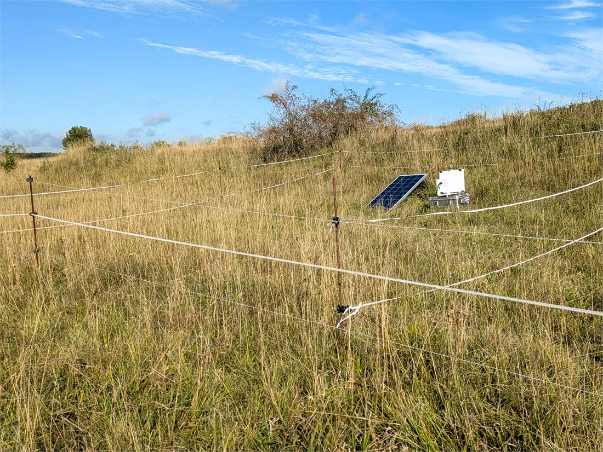
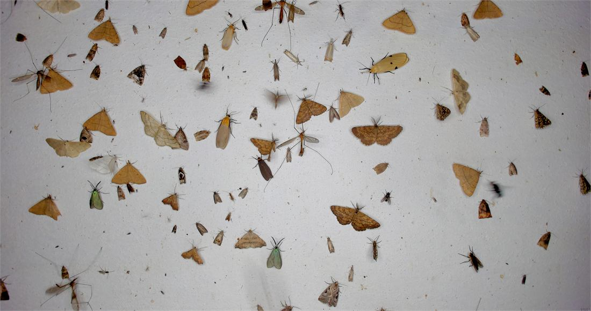
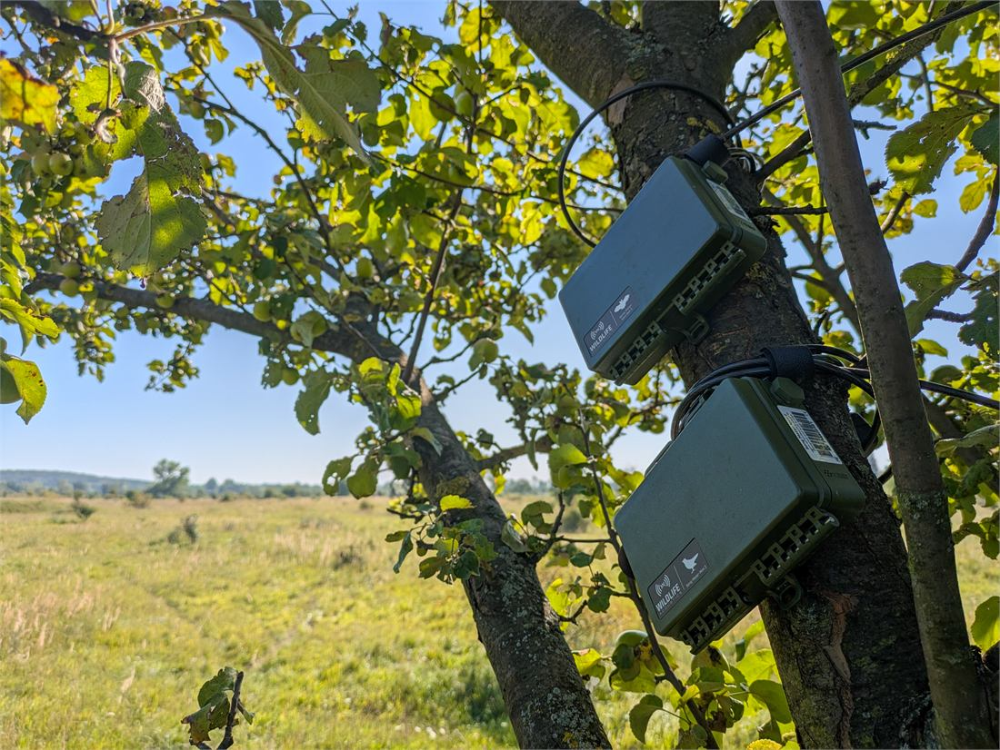
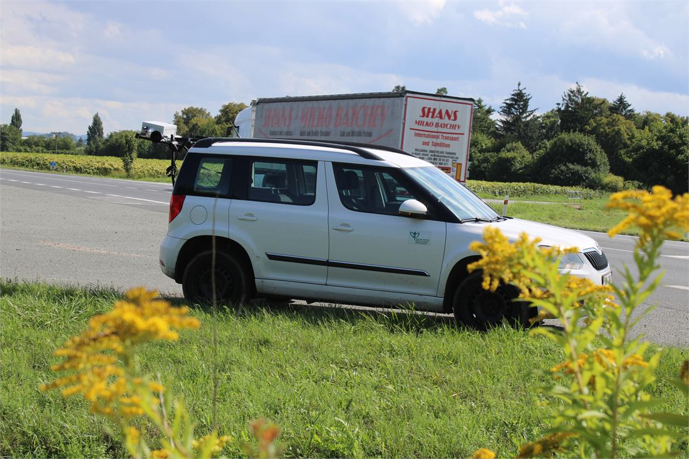
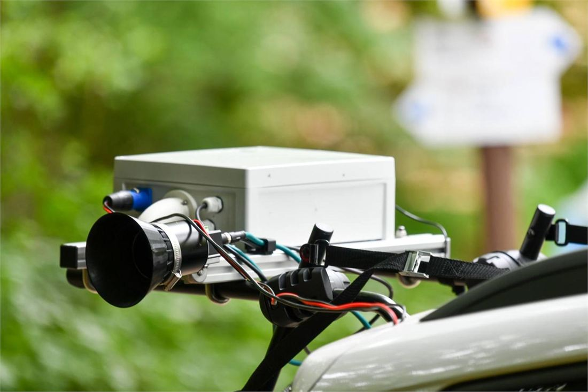
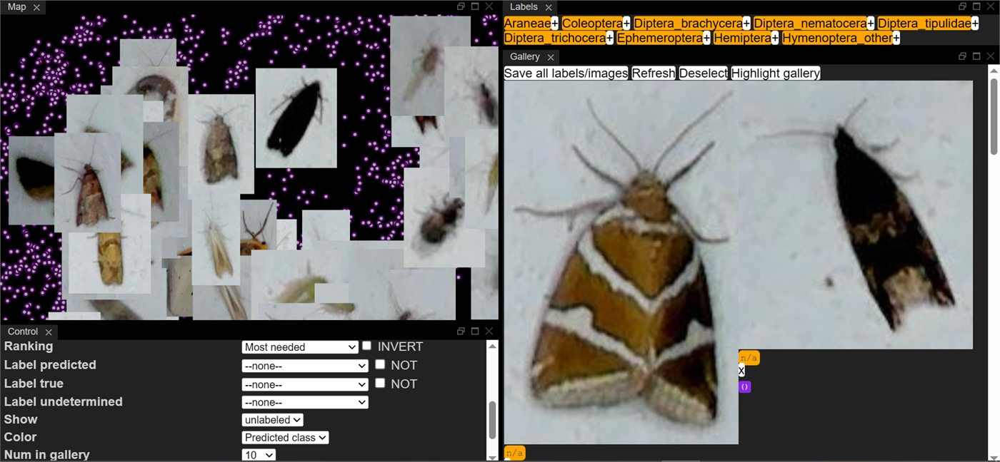

---
# ---------------------------------------------------------------------------
# index.qmd -- the front page of the MANTIS hub site.
#
# Its job is orientation, not persuasion: what the proposal is, the one figure
# that carries it, and where to go next -- the two pitch decks, and the
# initiatives MANTIS connects rather than duplicates.
#
# Every number, name and claim comes from
# documentation/MANTIS_Additional_Activity_Proposal_T2.5.3.docx.md, the same
# rule the figures and the decks obey: the proposal .docx is the only permitted
# source of facts about MANTIS. The outbound links are the only thing on this
# page sourced from elsewhere, and they point at those initiatives' own sites.
#
# The chain figure is not retyped here: its caption and alt text are read out
# of figures/fig01-connective-tissue.yml at render time. It needs
# out/fig01-a4.svg -- run targets::tar_make() first.
#
# The gallery loads images/gallery/*.jpg, not the originals in images/. This
# page embeds its resources, so every byte of a photograph is base64 in
# index.html: the gallery files are 1100 px derivatives of originals that run
# to 10 MB each. Regenerate them with tools/make-gallery.ps1 after replacing a
# source photograph.
# ---------------------------------------------------------------------------
# No `title:`. The hero below is the title block, and Quarto would otherwise
# print a second, unstyled "MANTIS" heading above it.
pagetitle: "MANTIS – a hub for monitoring with automated and novel technologies based on image and sound"
description-meta: >-
  MANTIS will form the connective tissue for automated monitoring with novel
  technologies based on image and sound across Europe. A Biodiversa+ WP2 Task
  2.5.3 additional activity, 2027-2028.
format:
  html:
    theme: site.scss
    embed-resources: true
    toc: false
    anchor-sections: false
    page-layout: full
    fig-align: center
---

```{r}
#| label: setup
#| include: false
for (f in c("profiles", "spec", "render", "checks", "document")) {
  source(file.path("R", paste0(f, ".R")))
}
spec <- Filter(function(s) identical(s$id, "fig01"), document_specs())[[1]]
```

```{=html}
<header class="hero" style="background-image: linear-gradient(100deg, rgba(13, 47, 77, 0.94) 0%, rgba(0, 145, 143, 0.86) 100%), url('images/20250703024959-snapshot.jpg');">
<div class="hero__inner">
<p class="hero__mark">MANTIS</p>
<p class="hero__title">A hub for Monitoring with Automated and Novel Technologies based on Image and Sound</p>
<p class="hero__lede">Sensors are already in the ground across Europe. MANTIS builds the <strong>connective tissue</strong> that turns them into one connected, transnational monitoring system rather than isolated national deployments.</p>
<ul class="hero__meta">
<li>Biodiversa+ WP2 · Task 2.5.3 additional activity</li>
<li>Aarhus University with the Nature Conservation Agency CZ</li>
<li>1 January 2027 – 30 September 2028</li>
<li>€796,850.18 requested</li>
<li>Core Activity 3 primary · CA2 and CA4 secondary</li>
</ul>
</div>
</header>
```

## The proposal in one figure

```{r}
#| label: chain
#| output: asis
# Caption and alt text come from the spec, not from this file: there is one
# copy of each, and it lives with the figure it describes.
cat(figure_block(spec, profile = "a4", fmt = "html"))
```

[The numbered gates on the connectors – deployment registration, expert verification, AI benchmarking, standards conformance – are the activity. Almost everything either side of them already exists somewhere in Europe, which is why MANTIS is a hub rather than a new monitoring scheme.]{.section-lede}

## Start here

```{=html}
<div class="cards cards--decks">
<a class="card" href="core-pitch.html">
<span class="card__kicker">5 slides · 5–6 minutes</span>
<span class="card__title">Core pitch</span>
<span class="card__body">The argument distilled: what MANTIS is, the problem it answers, the chain figure, and what exists at the end of the activity with what it costs.</span>
<span class="card__meta">An opening, three slides, a close.</span>
</a>
<a class="card" href="full-pitch.html">
<span class="card__kicker">13 slides · 7–10 minutes</span>
<span class="card__title">Full pitch</span>
<span class="card__body">The whole case for decision makers: the deployments that already exist, the three bottlenecks, five objectives with dates and thresholds, nineteen activities, the budget tiers and the plan for after 2028.</span>
<span class="card__meta">Speaker notes on every slide.</span>
</a>
</div>
```

## What the activity does

**Connect data acquisition** – align protocols, deployments and annotations across partners, and extend spatial and taxonomic coverage with new sensor deployments. [Package 1 · seven activities · Core Activity 2]{.quiet}

**Connect the data** – harmonise datasets and metadata into a seamless, quality-controlled flow from images and sounds to indicators, including transnational benchmarking of AI models. [Package 2 · five activities · Core Activity 3, primary]{.quiet}

**Connect the community** – link the users of these technologies to one another, and to the skills and resources that sustain a transnational effort. [Package 3 · seven activities · Core Activity 4]{.quiet}

[Nineteen activities in all, with nine deliverables and sixteen milestones between 1 January 2027 and 30 September 2028. MANTIS positions itself as a progenitor for a Thematic Hub associated with an EBOCC, and establishes no new operational structure: the outputs sit on GitHub Pages, GBIF and Zenodo, and the verification capacity rests on statutory Habitats and Birds Directive duties that continue anyway.]{.section-lede}

## What it delivers, and by when

| | Target and indicator | Deadline |
|:---|:---|:---|
| **O1** Every deployment registered, in one place | 100% of active AMI, CamAlien and acoustic deployments across ≥8 partner countries, registered and machine-readable in a Camtrap DP-compliant master database | 30 Sep 2028 |
| **O2** Sensor data reaches policy without bespoke analysis | ≥4 finalised indicators live on the MANTIS dashboard, each mapped to NRR Art. 10 / EU-PoMS, the Habitats Directive, the Birds Directive or IAS Regulation 1143/2014, and auto-updating from GBIF | 30 Sep 2028 |
| **O3** Data to benchmark AI against | ≥5,000 expert-verified annotations published under FAIR principles, including ≥2,000 NewtCam annotations; ≥20% reviewed by experts from ≥2 countries | 31 Dec 2027 |
| **O4** Partners can run this themselves | 25 summer-school participants from ≥12 countries; ≥20 distinct organisations attending ≥1 of the 8 online events | 30 Jun 2028 |
| **O5** A pathway beyond Biodiversa+ | Roadmap endorsed by ≥2/3 of partners at BioMonWeek 2028, naming ≥2 concrete funding or hosting pathways | 30 Jun 2028 |

## The devices, in the field

[Three device families run through every activity: AMI traps for nocturnal insects, acoustic recorders for birds, bats and amphibians, and the vehicle-mounted CamAlien for invasive plants along roads. These are partner deployments as they stand today -- the sensors MANTIS registers, upgrades and benchmarks rather than replaces.]{.section-lede}

```{=html}
<div class="gallery">
<figure class="gallery__item">

<figcaption><span class="gallery__kicker">AMI trap</span>A camera trap for nocturnal insects, running unattended on solar power in dry grassland. Activity 1.4 retrofits deployments like this one with modems and SIM cards so health checks and image transfer happen remotely instead of by field visit.</figcaption>
</figure>
<figure class="gallery__item">

<figcaption><span class="gallery__kicker">One frame, one night</span>What the trap actually returns: an illuminated sheet, photographed at intervals through the night. The volume of images like this is what has outgrown the community's capacity to verify them – the bottleneck the hub exists to address.</figcaption>
</figure>
<figure class="gallery__item">

<figcaption><span class="gallery__kicker">Acoustic recorders</span>Song Meter units at a meadow edge, recording audible and ultrasound. A substantial share of deployed recorders still need a manual visit to retrieve data; Activity 1.2 upgrades them for solar power and cellular remote access.</figcaption>
</figure>
<figure class="gallery__item">

<figcaption><span class="gallery__kicker">CamAlien</span>A high-speed, car-mounted camera system with automated image capture and GPS processing. Roads are a principal vector for invasive alien species, so mapping them from a moving vehicle is early detection under IAS Regulation 1143/2014.</figcaption>
</figure>
<figure class="gallery__item">

<figcaption><span class="gallery__kicker">The rig up close</span>Lens, housing and control box on the roof bar. Activity 1.2 installs new onboard computers and GPS so images are classified in real time on the vehicle, shortening the gap between observation and actionable knowledge.</figcaption>
</figure>
<figure class="gallery__item">

<figcaption><span class="gallery__kicker">Expert verification</span>The other half of the chain. Experts review AI-proposed identifications to build the reference dataset that benchmarking depends on – at least 5,000 verified annotations, a fifth of them checked in two countries, by the end of 2027.</figcaption>
</figure>
</div>
```

## Related initiatives

[MANTIS connects work that already exists rather than repeating it. These are the schemes, projects and infrastructures its activities build on, feed into, or are designed to stay interoperable with.]{.section-lede}

```{=html}
<div class="cards cards--links">
<a class="card" href="https://www.biodiversa.eu/" target="_blank" rel="noopener">
<span class="card__kicker">The partnership</span>
<span class="card__title">Biodiversa+</span>
<span class="card__body">The European Biodiversity Partnership. MANTIS is an additional activity under WP2, Task 2.5.3.</span>
</a>
<a class="card" href="https://www.biodiversa.eu/biodiversity-monitoring/pilots/ias-pilot/" target="_blank" rel="noopener">
<span class="card__kicker">Pilot 2.6.2</span>
<span class="card__title">IAS pilot</span>
<span class="card__body">Image-based monitoring of invasive alien species – an AMI trap and a CamAlien unit in ten countries. Takes on the registration system and the Camtrap DP implementations.</span>
</a>
<a class="card" href="https://www.biodiversa.eu/biodiversity-monitoring/pilots/abms-pilot/" target="_blank" rel="noopener">
<span class="card__kicker">Pilot 2.6.5</span>
<span class="card__title">ABMS pilot</span>
<span class="card__body">Automated Biodiversity Monitoring Stations – AMI traps and acoustic recorders in three habitat types across eleven countries.</span>
</a>
<a class="card" href="https://biodivpond.github.io/" target="_blank" rel="noopener">
<span class="card__kicker">Pilot 2.6.8</span>
<span class="card__title">BiodivPond</span>
<span class="card__body">Standardised pond monitoring at continental scale, with acoustic recorders in ten countries. The underwater acoustic pilot and the NewtCam annotations connect here.</span>
</a>
<a class="card" href="https://www.mambo-project.eu/" target="_blank" rel="noopener">
<span class="card__kicker">Horizon Europe</span>
<span class="card__title">MAMBO</span>
<span class="card__body">AI models for image and sound recognition in EU biodiversity monitoring. MANTIS reuses them for benchmarking instead of training its own.</span>
</a>
<a class="card" href="https://tabmon-eu.nina.no/" target="_blank" rel="noopener">
<span class="card__kicker">Biodiversa+ project</span>
<span class="card__title">TABMON</span>
<span class="card__body">A pan-European passive acoustic monitoring network turning soundscapes into EBVs. Shared metadata structures and acoustic pipelines.</span>
</a>
<a class="card" href="https://cordis.europa.eu/project/id/101060639" target="_blank" rel="noopener">
<span class="card__kicker">EU research results</span>
<span class="card__title">CORDIS</span>
<span class="card__body">The Commission's record of the EU-funded projects MANTIS builds on, MAMBO among them – factsheets, deliverables and results.</span>
</a>
</div>
```

::: {.site-foot}
**Contact** – Jamie Alison, Aarhus University, <jalison@ecos.au.dk> · Jonas Gaigr, Nature Conservation Agency CZ, <jonas.gaigr@aopk.gov.cz>

Every number and claim on this site is taken from the proposal document; the figure is generated from a declarative spec and checked against facts extracted from that document before it is allowed to build. Source and build pipeline: [github.com/jonasgaigr/mantis-hub](https://github.com/jonasgaigr/mantis-hub).
:::
